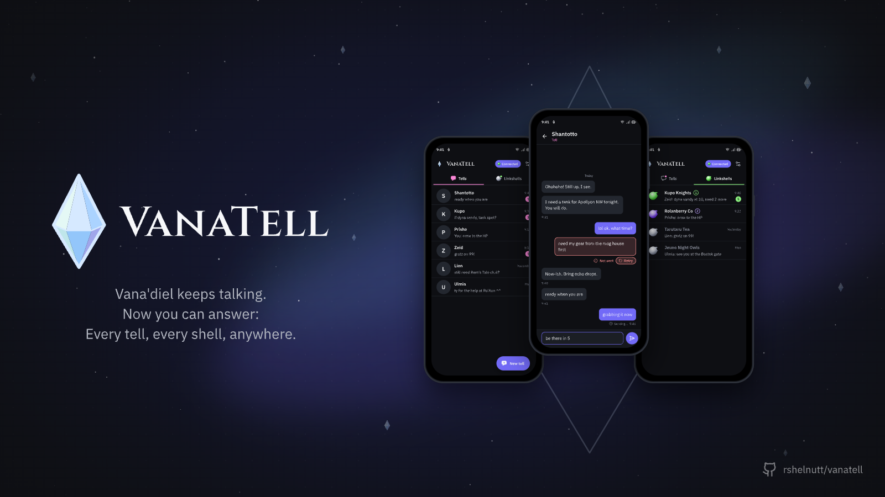

<p align="center">
  
</p>

<h1 align="center">VanaTell</h1>

<p align="center">
  <strong>Vana'diel keeps talking. Now you can answer: Every tell, every shell, anywhere.</strong>
</p>

<p align="center">
  
  
  
</p>

<p align="center">
  
</p>

---

## What it does

VanaTell is a Windower and Ashita addon that sends your tells, party chat and linkshell chat to the VanaTell app on your Android phone, so you can step away from the PC and still answer.

- **Tells, party, LS1 and LS2 on your phone.** Every tell you receive or send, and every party, LS1 and LS2 line, shows up in the app. Lines you type at the keyboard show up there too.
- **Answer from the phone.** Send a tell, a party line, an LS1 line or an LS2 line from the app, and the addon types it in game for you.
- **Linkshells detected for you.** The addon reads the name of the linkshell equipped in each slot, and whether a slot has one equipped at all, so the app files every line under the right shell.

Japanese chat is carried both ways: Japanese lines show on your phone as written, and Japanese you type on the phone reaches the game.

Say, shout, yell, emotes and system messages stay in game.

## Nothing to configure

The relay address is built in. There is no server to set up and no settings file to edit. The only thing you type is `//vt pair CODE` (on Ashita, `/vt pair CODE`), once.

## Requirements

- Final Fantasy XI on Windows with [Windower 4](https://www.windower.net/) or [Ashita v4](https://www.ashitaxi.com/)
- The VanaTell app on your Android phone

## Install

### Windower

1. Put the addon in `Windower4/addons/vanatell`. Either download `vanatell-vX.Y.Z.zip` from [Releases](../../releases) and unzip it into `Windower4/addons/`, or clone it:
   ```
   git clone https://github.com/rshelnutt/vanatell.git Windower4/addons/vanatell
   ```
   Either way, `Windower4/addons/vanatell/vanatell.lua` must exist.
2. In game, type `//lua load vanatell`.
3. To load it every time you start the game, add `lua load vanatell` to `Windower4/scripts/init.txt`.

### Ashita

1. Download `vanatell-ashita-vX.Y.Z.zip` from [Releases](../../releases) and unzip it into `Ashita/addons/`. `Ashita/addons/vanatell/vanatell.lua` must exist.
2. In game, type `/addon load vanatell`.
3. To load it every time you start the game, add `/addon load vanatell` to `Ashita/scripts/default.txt`, below the other `/addon load` lines.

Until it is paired, loading it prints:

```
VanaTell: not paired: run //vt pair <code> with the code from the VanaTell app
```

On Ashita the line says `/vt pair <code>`, with one slash.

## Pair

1. Open the VanaTell app. It shows a pairing code and the command to type. A code works once, within 10 minutes. Tap **Generate new code** if it runs out.
2. In game, type `//vt pair CODE` (on Ashita, `/vt pair CODE`) with the code from the app in place of `CODE`. Upper or lower case both work.
3. The game log shows `vanatell: paired (account ...)`, then `vanatell: connected to relay`. You're done.

To pair again later, open **Settings** in the app and tap **Generate new pairing code**.

## Commands

| Windower | Ashita | What it does |
| --- | --- | --- |
| `//vt pair CODE` | `/vt pair CODE` | Pair with the code shown in the app |
| `//vt status` | `/vt status` | Show the version, pairing, connection, queued messages and linkshells |
| `//vt on` / `//vt off` | `/vt on` / `/vt off` | Start or stop relaying |
| `//vt unpair` | `/vt unpair` | Forget this PC's pairing |
| `//vt update` | `/vt update` | Install the newest version, if there is one, and reload |
| `//vt rollback` | `/vt rollback` | Go back to the version before the last update, and reload |
| `//vt help` | `/vt help` | List the commands in game |
| `//vt url wss://host` | `/vt url wss://host` | Advanced: use your own relay. `//vt url default` (`/vt url default`) goes back to the built-in one |

`//vt status` (`/vt status` on Ashita) prints, for example:

```
VanaTell: version: 0.3.0
VanaTell: relay: built-in
VanaTell: paired: yes (account ...)
VanaTell: enabled: yes
VanaTell: connection: connected
VanaTell: queued: 0
VanaTell: linkshells: 1=KupoKnights 2=(none)
```

## Updating

Each time it loads, the addon asks vanatell.com once for the newest version number. If there is a newer one, it says so in the game log, for example `VanaTell 0.3.1 is available: type //vt update`. Nothing is downloaded until you type it.

`//vt update` (on Ashita, `/vt update`) downloads only the files that changed, checks each one's size and SHA-256 against the list vanatell.com publishes, copies the files it replaces into `backup/` in the addon folder, puts the new ones in place and reloads the addon, which then says `VanaTell: updated to 0.3.1`. If anything fails, no file is changed and the version you have keeps running. Your settings and pairing are never touched. You can type it any time; with the newest version it says `already up to date`.

`//vt rollback` (`/vt rollback`) puts back the files the last update replaced and reloads.

To update by hand instead, download the zip from [Releases](../../releases) as in Install.

## What is sent and what is not

**Sent to the relay**

- Each tell, party, LS1 and LS2 line: the channel, whether it came in or went out, who sent it, the tell target, the text, the time, and for linkshell lines the name of that linkshell.
- The names and colours of the linkshells equipped in slots 1 and 2, when they change.
- A keepalive every 30 seconds.

**Asked of vanatell.com**

- On load, and when you type `//vt update`, the newest version number and its file list. The request says only the addon's version and whether it is Windower or Ashita.

**Never sent**

- Say, shout, yell, emotes or system messages.
- Your inventory, gil, position, job or anything else from the game.

**What the phone can do in game**

- Only `/tell`, `/p`, `/l` and `/l2`. No other game, Windower or Ashita command can come from the phone, and text starting with `/` is refused.
- Text is cut at 150 bytes and `;` becomes `,`. Japanese is carried both ways; only characters the game lacks (emoji, for instance) show as `?`.

**On your PC**

- `addons/vanatell/data/settings.xml` holds the relay address and this PC's pairing token in plain text. Treat it like a password. `//vt unpair` wipes the token.
- On Ashita that file is `config/addons/vanatell/settings.json` in the Ashita folder, shared by all your characters. Treat it like a password too. `/vt unpair` wipes the token.
- Lines that arrive while the relay is out of reach wait in memory, up to 500, and are never written to disk.

Everything travels over an encrypted connection, and the addon checks the relay's certificate, and vanatell.com's for updates, against the small list of trust roots in `relay-roots.txt`. That file is not a certificate to install; it is only read by the addon.

## Troubleshooting

**`//lua load vanatell` says the addon does not exist.** The folder must be named exactly `vanatell`, with `vanatell.lua` directly inside it: `Windower4/addons/vanatell/vanatell.lua`. A zip from GitHub's **Code** button unzips as `vanatell-main`; rename it to `vanatell`.

**`/addon load vanatell` fails on Ashita.** The folder must be named exactly `vanatell`, with `vanatell.lua` directly inside it: `Ashita/addons/vanatell/vanatell.lua`. Use `vanatell-ashita-vX.Y.Z.zip` from [Releases](../../releases); the Windower zip and a zip from GitHub's **Code** button are the Windower addon and do not load in Ashita.

**`pairing failed: http 404`.** The addon is using an old relay address saved in `data/settings.xml`. Type `//vt url default`, then `//vt pair CODE` again. On Ashita, type `/vt url default`, then `/vt pair CODE`.

**`pairing failed: invalid_code`.** The code was mistyped, has run out or was already used. Get a new one in the app.

**Linkshell lines are missing, or status shows `linkshells: 1=(none)`.** That slot has no linkshell equipped. Equip the linkshell or pearl from your inventory or a wardrobe and the addon picks it up within a few seconds. `linkshells: unknown` means you are not logged in yet, or the game is still loading your inventory after a zone change.

**`relay rejected the addon token`.** This PC's pairing was replaced or revoked. Get a new code in the app and type `//vt pair CODE` (on Ashita, `/vt pair CODE`).

## Versioning

VanaTell follows [semantic versioning](https://semver.org). `//vt status` (`/vt status` on Ashita) shows the version you have, and [CHANGELOG.md](CHANGELOG.md) lists what changed in each one. Until 1.0, 0.x releases may change behaviour between minor versions.

Each release is published on the [Releases](../../releases) page as two zips: `vanatell-vX.Y.Z.zip` for Windower and `vanatell-ashita-vX.Y.Z.zip` for Ashita, for example `vanatell-v0.3.0.zip` and `vanatell-ashita-v0.3.0.zip`. Each holds exactly the `vanatell` addon folder: unzip the Windower one into `Windower4/addons/` and the Ashita one into `Ashita/addons/`.

## Licence

VanaTell is proprietary software, licensed and not sold: you may run the addon for your own play, and nothing more. It is published so players can read what runs alongside their game. See [LICENSE](LICENSE).
