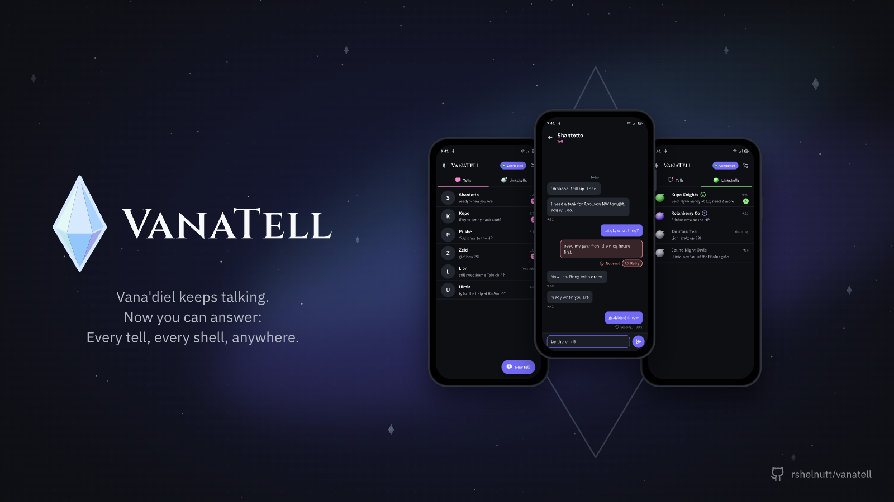

<p align="center">
  
</p>

<h1 align="center">VanaTell</h1>

<p align="center">
  <strong>Vana'diel keeps talking. Now you can answer: Every tell, every shell, anywhere.</strong>
</p>

<p align="center">
  
  
  <br />
  <a href="https://apps.apple.com/app/vanatell/id6834196011"></a>
  <a href="https://vanatell.com/download/android"></a>
  <br />
  
  <br />
  <a href="https://discord.gg/xfAJzhhN6D"></a>
</p>

<p align="center">
  
</p>

---

## What it does

Partner addon for the VanaTell app (iOS/Android). You need both: this addon in Windower or Ashita, and the app on your iPhone or Android device. The addon sends your tells, party chat and linkshell chat to the app, so you can step away from the PC and still answer.

- **Tells, party, LS1 and LS2 on your device.** Every tell you receive or send, and every party, LS1 and LS2 line, shows up in the app. Lines you type at the keyboard show up there too.
- **Answer from the device.** Send a tell, a party line, an LS1 line or an LS2 line from the app, and the addon types it in game for you.
- **Linkshells detected for you.** The addon reads the name of the linkshell equipped in each slot, and whether a slot has one equipped at all, so the app files every line under the right shell. Which slot a shell is in comes only from the game: its equip message when you zone or equip a shell, or, when the addon loads mid-session, the game's reply to `/lsmes` and `/ls2mes`, which the addon types for you and keeps out of your chat log. It never guesses.

Japanese chat is carried both ways: Japanese lines show on your device as written, and Japanese you type on the device reaches the game.

Say, shout, yell, emotes and system messages stay in game.

## Security

- **No account to steal.** No email, password or name. Your device and PC pair with a random token for the device and one for each character, and the server keeps only a one-way hash of each, never the tokens.
- **Only chat leaves the game.** Tells, party and both linkshells. Never say, shout or yell, your inventory, gil or position, and nothing from your Square Enix account.
- **Never writes packets.** The addon never writes or injects game packets. It reads chat, and from your device it can only type `/tell`, `/p`, `/l` and `/l2`, the way you would at the keyboard.
- **Encrypted in transit and at rest.** Every connection uses TLS, and the addon checks the server's certificate itself against `relay-roots.txt`. Stored lines are encrypted on Cloudflare's network.
- **Little kept, deleted on request.** The server keeps the newest 2,000 lines per character so your device can catch up. **Unpair this device** in the app deletes your account and everything stored, at once, though for 30 days a copy still exists in Cloudflare's point-in-time recovery of the relay's storage, which the relay cannot erase.
- **No tracking.** No analytics, ads, trackers or third-party SDKs, in the addon or the apps.
- **Read it yourself.** Every line of this addon is here in plain Lua. `//vt update` checks each file's SHA-256 against the published list before installing it. An update the addon makes by itself when the relay requires one is checked the same way.
- **Your chat text is encrypted.** When both the addon and the app are updated, the addon encrypts the text of every tell, party and linkshell line on your PC before it leaves, and only your device can decrypt it; what you type on the device is encrypted on the device, and only the addon can decrypt it. `//vt status` (on Ashita, `/vt status`) shows `encryption: on` when it is. Compare the safety code once (below): until you do, a relay could have put itself in the middle when encryption was set up, and the points below that say "only" depend on that check.
- **The keys stay on your PC and your device.** Each side makes its own key; only the public halves cross the relay. On Ashita the addon's key comes from Windows' system random generator. On Windower, which gives addons no system random source, the addon makes it from the timing of its own frames against your PC's clock and from the timing and content of the game's traffic and your mouse and keyboard input, none of which reaches the relay, and stops once encryption is on. On iPhone, notification text is decrypted on the device by the app's notification extension.
- **Check that no one is in between.** `//vt status` (on Ashita, `/vt status`) shows a safety code, and the app shows one in **Settings → Encryption**. Each character has its own: compare `//vt status` on each character with the app's code while that character is selected at the top of Home. If they match, your PC and device are talking only to each other. The keys change when you pair again, or when the addon replaces a lost key file using the recovery key it keeps with its pairing; the app then says the safety code changed. After you pair again, compare the new code: the app sets up encryption on the relay's report that you paired, so a relay could report a pairing you did not make. If it did, the app's code changes while the code in game stays the same.
- **Encryption can be held back, but not faked.** Until it turns on, and again after you pair again until it turns on again, the relay could keep it from turning on. If the app says your addon needs an update, or says it is still setting up, while `//vt status` (on Ashita, `/vt status`) says it is waiting for the app, encryption is being blocked.
- **Older lines are replaced, not left readable.** Once encryption is on, your device replaces every line the relay still holds readable with an encrypted copy, in place, at the same time and in the same conversation, so your history reads as it did. Lines that pass through while a new pairing is being set up are replaced the same way. Cloudflare keeps point-in-time recovery of the relay's storage for 30 days, and the relay cannot erase it: for 30 days after a line is replaced, its readable copy still exists in that recovery data.
- **Moving to a new device.** In the app, **Settings → Encryption** shows a restore key, with Copy and Download. On a new device, after setting up and pairing as usual, **Restore from key** moves your old account's stored messages, the newest 2,000 lines of every character, into the new account and lets it read them; the old account is then deleted. Keep this key secure. Anyone with it can restore your messages. We can't recover it if it's lost. The relay keeps only a copy of your keys sealed under the key, which it cannot open.
- **See what the relay holds.** In the app, **Settings → Encryption → See what the server holds** shows your newest stored lines exactly as the relay returns them.
- **After you have compared the codes, the relay can't type for you.** The addon then types only what your device encrypted, and each of those only once.
- **Updates.** Once encryption is on for your account, the relay turns away a version of the addon without encryption. A version that can update itself then does so from vanatell.com, checking every file's size and SHA-256 as `//vt update` does; an older one tells you to type `//vt update`. Otherwise the addon updates only when you type `//vt update`.
- **What the relay still sees.** Who each line is from and to, the channel, whether it came in or went out, the linkshell's name and the times. It needs them to file lines under the right linkshell, apply your mutes and send your replies to the right place.

The full detail: [What is sent and what is not](#what-is-sent-and-what-is-not), and [vanatell.com/privacy](https://vanatell.com/privacy).

## Help and community

Join the VanaTell server on Discord: [discord.gg/xfAJzhhN6D](https://discord.gg/xfAJzhhN6D)

- **Questions:** ask in #help.
- **Bugs:** use **Report a bug** in #bug-reports.
- **Ideas:** post them in #feature-requests.

## Nothing to configure

The relay address is built in. There is no server to set up and no settings file to edit. The only thing you type is `//vt pair CODE` (on Ashita, `/vt pair CODE`), once on each character.

## Requirements

- Final Fantasy XI on Windows with [Windower 4](https://www.windower.net/) or [Ashita v4](https://www.ashitaxi.com/)
- The VanaTell app on your device: [iPhone, from the App Store](https://apps.apple.com/app/vanatell/id6834196011), or [Android, from vanatell.com](https://vanatell.com/download/android)

## Install

### Windower

1. Put the addon in `Windower4/addons/vanatell`. Either download `vanatell-vX.Y.Z.zip` from [Releases](../../releases) and unzip it into `Windower4/addons/`, or clone it:
   ```
   git clone https://github.com/rshelnutt/vanatell.git Windower4/addons/vanatell
   ```
   Either way, `Windower4/addons/vanatell/vanatell.lua` must exist.
2. In game, type `//lua load vanatell`.
3. To load it every time you start the game, add `lua load vanatell` to `Windower4/scripts/init.txt`.

### Ashita

1. Download `vanatell-ashita-vX.Y.Z.zip` from [Releases](../../releases) and unzip it into `Ashita/addons/`. `Ashita/addons/vanatell/vanatell.lua` must exist.
2. In game, type `/addon load vanatell`.
3. To load it every time you start the game, add `/addon load vanatell` to `Ashita/scripts/default.txt`, below the other `/addon load` lines.

Until it is paired, loading it prints:

```
VanaTell: not paired: run //vt pair <code> with the code from the VanaTell app
```

On Ashita the line says `/vt pair <code>`, with one slash.

## Pair

1. Open the VanaTell app. It shows a pairing code and the command to type. A code works for every character that types it until you tap **Complete pairing**, or for 10 minutes. Tap **Generate new code** if it runs out.
2. In game, type `//vt pair CODE` (on Ashita, `/vt pair CODE`) with the code from the app in place of `CODE`. Upper or lower case both work.
3. The game log shows `VanaTell: paired (account ...)`, then `VanaTell: connected to relay`, and the app counts the character, for example `1/6 characters paired`, with its name. Type the same command on each character you'd like to connect, on this PC or another, then tap **Complete pairing** in the app. You're done.

Once the app is updated too, encryption sets itself up within a few seconds, with nothing to tap or type. The game log then says `VanaTell: encryption on. Safety code: ...`, and `//vt status` (on Ashita, `/vt status`) shows the same code as the app's **Settings → Encryption**.

To pair a character again later, open **Settings → Characters** in the app and tap **Pair again** on its row. To add a character, tap **Add a character** there, up to 6 characters.

## Commands

| Windower | Ashita | What it does |
| --- | --- | --- |
| `//vt pair CODE` | `/vt pair CODE` | Pair with the code shown in the app |
| `//vt status` | `/vt status` | Show the version, pairing, connection, queued messages and linkshells |
| `//vt on` / `//vt off` | `/vt on` / `/vt off` | Start or stop relaying |
| `//vt unpair` | `/vt unpair` | Forget this character's pairing |
| `//vt update` | `/vt update` | Install the newest version, if there is one, and reload |
| `//vt rollback` | `/vt rollback` | Go back to the version before the last update, and reload |
| `//vt help` | `/vt help` | List the commands in game |

`//vt status` (`/vt status` on Ashita) prints, for example:

```
VanaTell: version: X.Y.Z
VanaTell: paired: yes (account ...)
VanaTell: enabled: yes
VanaTell: connection: connected
VanaTell: queued: 0
VanaTell: linkshells: 1=KupoKnights 2=(none)
VanaTell: encryption: on, safety code 1234 5678 9012
```

## Updating

Each time it loads, the addon asks vanatell.com once for the newest version number. If there is a newer one, it says so in the game log, for example `VanaTell X.Y.Z is available: type //vt update`. Nothing is downloaded until you type it, or until the relay requires an update (below).

`//vt update` (on Ashita, `/vt update`) downloads only the files that changed, checks each one's size and SHA-256 against the list vanatell.com publishes, copies the files it replaces into `backup/` in the addon folder, puts the new ones in place and reloads the addon, which then says `VanaTell: updated to X.Y.Z`. Lines waiting to be sent are kept across the reload. If anything fails, no file is changed and the version you have keeps running. Your settings and pairing are never touched. You can type it any time; with the newest version it says `already up to date`.

The addon also updates itself when the relay requires it. If the relay refuses this version, the addon says `VanaTell: encryption is on for this account; updating to the newest version` and runs the same update as `//vt update`, with every check it makes, at most once every 10 minutes. Lines said meanwhile are kept and sent once it reconnects. With `//vt off` (`/vt off`) the addon does not connect, so it never updates by itself.

`//vt rollback` (`/vt rollback`) puts back the files the last update replaced and reloads. Lines waiting to be sent are kept across the reload when the version it goes back to is this one or newer. Once encryption is on for your account, it will not go back to a version without encryption.

To update by hand instead, download the zip from [Releases](../../releases) as in Install.

## What is sent and what is not

**Sent to the relay**

- Each tell, party, LS1 and LS2 line: the channel, whether it came in or went out, who sent it, the tell target, the text, the time, and for linkshell lines the name of that linkshell. Once encryption is on, the text is encrypted on your PC and the relay cannot read it; the rest stays readable so the relay can file and route the line.
- The names and colours of the linkshells equipped in slots 1 and 2, when they change.
- A keepalive every 30 seconds.

**Asked of vanatell.com**

- On load, when you type `//vt update`, and when the relay requires an update, the newest version number and its file list. The request says only the addon's version and whether it is Windower or Ashita.

**Never sent**

- Say, shout, yell, emotes or system messages.
- Your inventory, gil, position, job or anything else from the game.

**What the device can do in game**

- Only `/tell`, `/p`, `/l` and `/l2`. No other game, Windower or Ashita command can come from the device, and text starting with `/` is refused.
- Text is cut at 150 bytes and `;` becomes `,`. Japanese is carried both ways; only characters the game lacks (emoji, for instance) show as `?`.

**On your PC**

- `addons/vanatell/data/<character>/settings.xml` holds that character's pairing token in plain text, one folder for each character. Treat it like a password. `//vt unpair` on that character wipes the token.
- On Ashita that file is `config/addons/vanatell/<character>/settings.json` in the Ashita folder, one folder for each character. Treat it like a password too. `/vt unpair` wipes the token.
- `addons/vanatell/data/<character>/e2e.json` (on Ashita, `config/addons/vanatell/<character>/e2e.json`) holds that character's encryption keys. Treat it like a password. `//vt unpair` wipes it. The settings file also keeps a recovery key, so a lost `e2e.json` can be replaced without pairing again.
- `entropy.seed`, next to it, holds only a hash used to make future keys quickly.
- Lines that arrive while the relay is out of reach wait in memory, up to 500. They are written to disk only for the seconds the reload of an update or a rollback takes, in `addons/vanatell/data/<character>/queue.json` (on Ashita, `config/addons/vanatell/<character>/queue.json`), then read back and deleted.

Everything travels over an encrypted connection, and the addon checks the relay's certificate, and vanatell.com's for updates, against the small list of trust roots in `relay-roots.txt`. That file is not a certificate to install; it is only read by the addon.

## Troubleshooting

**`//lua load vanatell` says the addon does not exist.** The folder must be named exactly `vanatell`, with `vanatell.lua` directly inside it: `Windower4/addons/vanatell/vanatell.lua`. A zip from GitHub's **Code** button unzips as `vanatell-main`; rename it to `vanatell`.

**`/addon load vanatell` fails on Ashita.** The folder must be named exactly `vanatell`, with `vanatell.lua` directly inside it: `Ashita/addons/vanatell/vanatell.lua`. Use `vanatell-ashita-vX.Y.Z.zip` from [Releases](../../releases); the Windower zip and a zip from GitHub's **Code** button are the Windower addon and do not load in Ashita.

**`pairing failed: invalid_code`.** The code was mistyped, has run out or was already used. Get a new one in the app.

**`pairing failed: this device already has 6 characters`.** Your device holds at most 6 paired characters. To pair another, remove one in the app: **Settings → Characters**, **Remove** on its row. That deletes its messages from your device and the server.

**`pairing failed: update the VanaTell app on your device to add another character`.** The app on your device can hold only one character until it is updated. Update it, then tap **Add a character** in **Settings → Characters** and type the new code on this character.

**`pairing failed: type //vt update (on Ashita, /vt update), then pair again`.** This copy of the addon can't say which character it is, and your account already has two or more. Type `//vt update` (on Ashita, `/vt update`), then `//vt pair CODE` (on Ashita, `/vt pair CODE`) again.

**`encryption is on for this account; updating to the newest version`, on an account with two or more characters.** An older addon says this whenever the relay turns it away, whatever the reason. Here the reason is that it can't say which character it is. It updates itself as the line says, then connects as its character, with nothing to type.

**Linkshell lines are missing, or status shows `linkshells: 1=(none)`.** That slot has no linkshell equipped. Equip the linkshell from your inventory, Mog Satchel, Sack or Case and the addon picks it up within a few seconds. `linkshells: unknown` means you are not logged in yet, or the game is still loading your inventory after a zone change.

**Status shows `linkshells: Regalia, MyPearl (slots not known yet)`.** The game has not said which slot each shell is in. The addon asked with `/lsmes` and `/ls2mes` and got no reply, which happens when neither linkshell has a message set. Until the game says, linkshell lines arrive in the app under "Unknown linkshell" and a reply to a linkshell from the device fails rather than go to the wrong one. Zone or equip a shell again and the lines move to the right linkshell.

**`relay rejected the addon token`.** This PC's pairing was replaced or revoked. Get a new code in the app and type `//vt pair CODE` (on Ashita, `/vt pair CODE`).

**Something else?** Ask in #help on the [VanaTell Discord](https://discord.gg/xfAJzhhN6D), or report it with **Report a bug** in #bug-reports.

## Versioning

VanaTell follows [semantic versioning](https://semver.org). `//vt status` (`/vt status` on Ashita) shows the version you have, and [CHANGELOG.md](CHANGELOG.md) lists what changed in each one. Until 1.0, 0.x releases may change behaviour between minor versions.

Each release is published on the [Releases](../../releases) page as two zips: `vanatell-vX.Y.Z.zip` for Windower and `vanatell-ashita-vX.Y.Z.zip` for Ashita. Each holds exactly the `vanatell` addon folder: unzip the Windower one into `Windower4/addons/` and the Ashita one into `Ashita/addons/`.

## Licence

VanaTell is proprietary software, licensed and not sold: you may run the addon for your own play, and nothing more. It is published so players can read what runs alongside their game. See [LICENSE](LICENSE).
